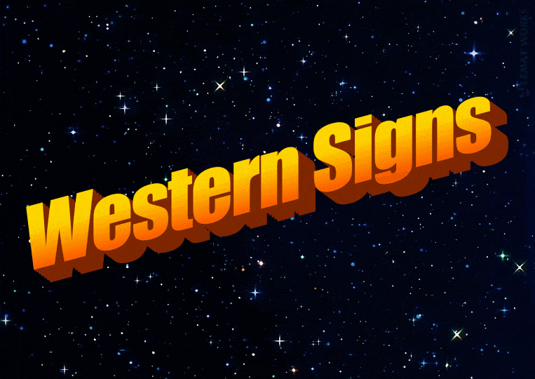

# Western ✨ Signs

Simple interface for [western astrological](https://en.wikipedia.org/wiki/Western_astrology) signs.

[](https://www.npmjs.com/package/western-signs)
[](LICENSE)
[](https://github.com/marcmarine/western-signs/releases)
[](https://marcmarine.github.io/western-signs)


The **Western Signs** library provides detailed information about each astrological sign, including its `element`, `modality`, `rulers` and `glyph`, among other things, as identifiers you can compare and translate into several languages.

<details close>
<summary>WordArt</summary>



</details>

## Installation

To install dependencies:

```bash
npm install western-signs
```

## Usage

### Zodiac

The `zodiac` object groups signs, planets, houses and aspects under a single API. Every group uses the same methods: `get` returns one item by its identifier, or by number for houses, and `all` returns the full list.

```js
import { zodiac, ASPECTS, SIGNS, PLANETS } from 'western-signs'

zodiac.signs.get(SIGNS.TAURUS)
zodiac.signs.all()

zodiac.planets.get(PLANETS.VENUS)
zodiac.planets.all()

zodiac.houses.get(7)
zodiac.houses.all()

zodiac.aspects.get(ASPECTS.TRINE)
zodiac.aspects.all()
```

`zodiac.signs.get(SIGNS.TAURUS)` returns an object with the following properties:

```js
{
  id: 'taurus',
  bodyPart: 'throat',
  character: 'bull',
  element: 'earth',
  glyph: '♉',
  longitude: { start: 30, end: 60 },
  modality: 'fixed',
  number: 2,
  polarity: 'negative',
  rulers: { modern: 'venus', traditional: 'venus' },
  season: 'spring'
}
```

Values are identifiers, the same in every language, so you can compare them with the exported constants:

```js
import { ELEMENTS } from 'western-signs'

zodiac.signs.get(SIGNS.TAURUS).element === ELEMENTS.EARTH
// Output: true
```

To show them, translate them with [`i18n.label()`](#translations). The returned objects are frozen: copy one before changing it.

`rulers` holds the modern ruler and the traditional one, from before the discovery of the outer planets; they differ only for Scorpio, Aquarius and Pisces.

`longitude` is the range of the sign along the ecliptic, in degrees from 0° Aries, the start included and the end excluded. The Sun is in Taurus while [`sun.longitude()`](#sun-sign-by-date) is between 30 and 60.

#### Sun sign by date

Use `at()` to get the Sun's position at a given moment. Pass the local date and time with the time zone of the place, e.g. where someone was born:

```js
const { sun } = zodiac.at({
  date: '2024-05-05T14:00',
  timeZone: 'Europe/Madrid',
})

sun.sign()
// Output: { id: 'taurus', ... }

sun.longitude()
// Output: 45.48... (degrees along the ecliptic, from 0° Aries)

sun.degree()
// Output: 15.48... (degrees within the sign)
```

The date is written as `YYYY-MM-DD`, optionally followed by a time, `THH:mm` or `THH:mm:ss`, the same format `<input type="datetime-local">` gives. The time zone is an [IANA name](https://en.wikipedia.org/wiki/List_of_tz_database_time_zones) such as `'Europe/Madrid'`, so daylight saving time and historical changes are taken into account. If the time is unknown, noon is used, which can give the wrong sign on the day the Sun changes sign.

You can also pass a `Date` if you already have the exact instant:

```js
zodiac.at({ date: new Date('2024-05-05T12:00:00Z') }).sun.sign()
```

Keep in mind that `new Date(2024, 4, 5)` is midnight in the time zone of the machine running the code, not of the place you mean.

The position is computed with Jean Meeus' low-precision solar algorithm (accurate to about 0.01°), so the change of sign falls on the right day each year.

> [!TIP]
> If you only know the city, a library such as [`i18n-cities`](https://www.npmjs.com/package/i18n-cities) gives you its time zone:
>
> ```js
> const [city] = cities.search('barcelona')
>
> zodiac.at({ date: '1990-03-20T05:00', timeZone: city.timezone })
> ```

#### Translations

Only English is included by default. Other languages must be explicitly imported to be available:

```js
import 'western-signs/locale/es'
```

`i18n.label()` translates every value of a sign, planet, house or aspect. It keeps the `id` and adds its translation as `name`:

```js
import { i18n, SIGNS, zodiac } from 'western-signs'

i18n.label(zodiac.signs.get(SIGNS.TAURUS), 'es')
// Output: { id: 'taurus', name: 'Tauro', element: 'Tierra', rulers: { modern: 'Venus', ... }, ... }

i18n.label(
  zodiac.at({ date: '2024-05-05', timeZone: 'Europe/Madrid' }).sun.sign(),
  'es',
).name
// Output: Tauro
```

Without a language, it translates into English. To work in one language without passing it on every call, use [`i18n.locale()`](#internationalization):

```js
const es = i18n.locale('es')

es.label(zodiac.signs.get(SIGNS.TAURUS)).name
// Output: Tauro

es.t(SIGNS.TAURUS)
// Output: Tauro
```

### Symbols

The `getSymbol` function allows you to retrieve SVG representations of astrological symbols, with options to customize their appearance.

| parameter        | type                            | default          | description                                                    |
| ---------------- | ------------------------------- | ---------------- | -------------------------------------------------------------- |
| name             | `string`                        | —                | Symbol identifier. See constants `PLANETS`, `SIGNS`, `ASPECTS` |
| width            | `number`                        | `24`             | Width in pixels of the generated SVG                           |
| height           | `number`                        | `24`             | Height in pixels                                               |
| stroke           | `string`                        | `'currentColor'` | Stroke color as hex, rgb, or CSS variable                      |
| stroke-width     | `number`                        | `1`              | Stroke thickness in logical pixels                             |
| stroke-linecap   | `'butt' \| 'round' \| 'square'` | `'round'`        | Shape of stroke endpoints                                      |
| stroke-linejoin  | `'miter' \| 'round' \| 'bevel'` | `'round'`        | Shape of stroke corners and joins                              |
| nonScalingStroke | `boolean`                       | `true`           | Prevents stroke from scaling when the SVG is resized           |

```js
import { getSymbol, SIGNS } from 'western-signs'

const symbol = getSymbol(SIGNS.TAURUS, {
  width: 24,
  height: 24,
  stroke: 'currentColor',
  'stroke-width': 1,
})

console.log(symbol.toString())
// Outputs: An SVG string with customized attributes

console.log(symbol.toDataURL())
// Outputs: A Data URL representation of the SVG
```

#### Available symbols

Three groups of exported constants. Use the identifier with getSymbol().

| group   | symbols                                                                                                                            |
| ------- | ---------------------------------------------------------------------------------------------------------------------------------- |
| PLANETS | `SUN` `MOON` `MERCURY` `VENUS` `MARS` `JUPITER` `SATURN` `URANUS` `NEPTUNE` `PLUTO`                                                |
| SIGNS   | `ARIES` `TAURUS` `GEMINI` `CANCER` `LEO` `VIRGO` `LIBRA` `SCORPIO` `SAGITTARIUS` `CAPRICORN` `AQUARIUS` `PISCES`                   |
| ASPECTS | `CONJUNCTION` `SEMISEXTILE` `SEMISQUARE` `SEXTILE` `QUINTILE` `SQUARE` `TRINE` `SESQUISQUARE` `BIQUINTILE` `QUINCUNX` `OPPOSITION` |
| ANGLES  | `ASCENDANT`                                                                                                                        |

> [!TIP]
>
> #### React projects
>
> For React projects, you can find compatible astrology symbol components in the [Astroicons repository](https://github.com/marcmarine/astroicons).

### Internationalization

The `t` function translates a single identifier, such as an aspect or an element. It translates into English unless you pass a language, and returns the key itself if no translation is found. To translate a whole sign, planet, house or aspect, use [`i18n.label()`](#translations).

```js
import { ASPECTS, i18n } from 'western-signs'

// Importing a locale makes its translations available
import 'western-signs/locale/es'

i18n.t(ASPECTS.CONJUNCTION)
// Output: Conjunction

i18n.t(ASPECTS.CONJUNCTION, 'es')
// Output: Conjunción
```

There is no global language. To work in one language, e.g. the one your app is shown in, fix it once with `i18n.locale()` and use the functions it returns:

```js
const { t, label } = i18n.locale('es')

t(ASPECTS.CONJUNCTION)
// Output: Conjunción
```


#### Available languages

Languages are opt-in and must be imported explicitly:

- `western-signs/locale/en` — English (default)
- `western-signs/locale/es` — Spanish
- `western-signs/locale/ca` — Catalan

### Data as JSON

The data behind the library is also published as JSON, for projects that don't run JavaScript or just want the data: a script in another language, a database seed, or the context given to a language model.

`data.json` has `signs`, `planets`, `houses` and `aspects`, whose values are ids instead of translated text. Each language has its own file in `locale/` that maps every id to its label, so load `data.json` together with the languages you need, even if only English:

```js
import data from 'western-signs/data.json' with { type: 'json' }
import ca from 'western-signs/locale/ca.json' with { type: 'json' }

const taurus = data.signs[1]
// { id: 'taurus', element: 'earth', modality: 'fixed', longitude: { start: 30, end: 60 }, ... }

ca[taurus.element]
// Output: Terra
```

Or without installing anything, from a CDN:

```
https://cdn.jsdelivr.net/npm/western-signs@1/dist/data.json
https://cdn.jsdelivr.net/npm/western-signs@1/dist/locale/ca.json
```

## API Reference

### Variables

- [zodiac](https://marcmarine.github.io/western-signs/variables/zodiac)

### Functions

- [getSymbol](https://marcmarine.github.io/western-signs/functions/getSymbol)

### Interfaces

- [Aspect](https://marcmarine.github.io/western-signs/interfaces/Aspect)
- [House](https://marcmarine.github.io/western-signs/interfaces/House)
- [Planet](https://marcmarine.github.io/western-signs/interfaces/Planet)
- [Sign](https://marcmarine.github.io/western-signs/interfaces/Sign)

For more detailed API information, please check out the [documentation](https://marcmarine.github.io/western-signs).

## License

MIT License © 2024 [Marc Mariné](https://github.com/marcmarine)
